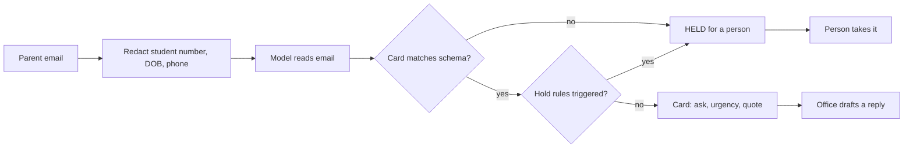
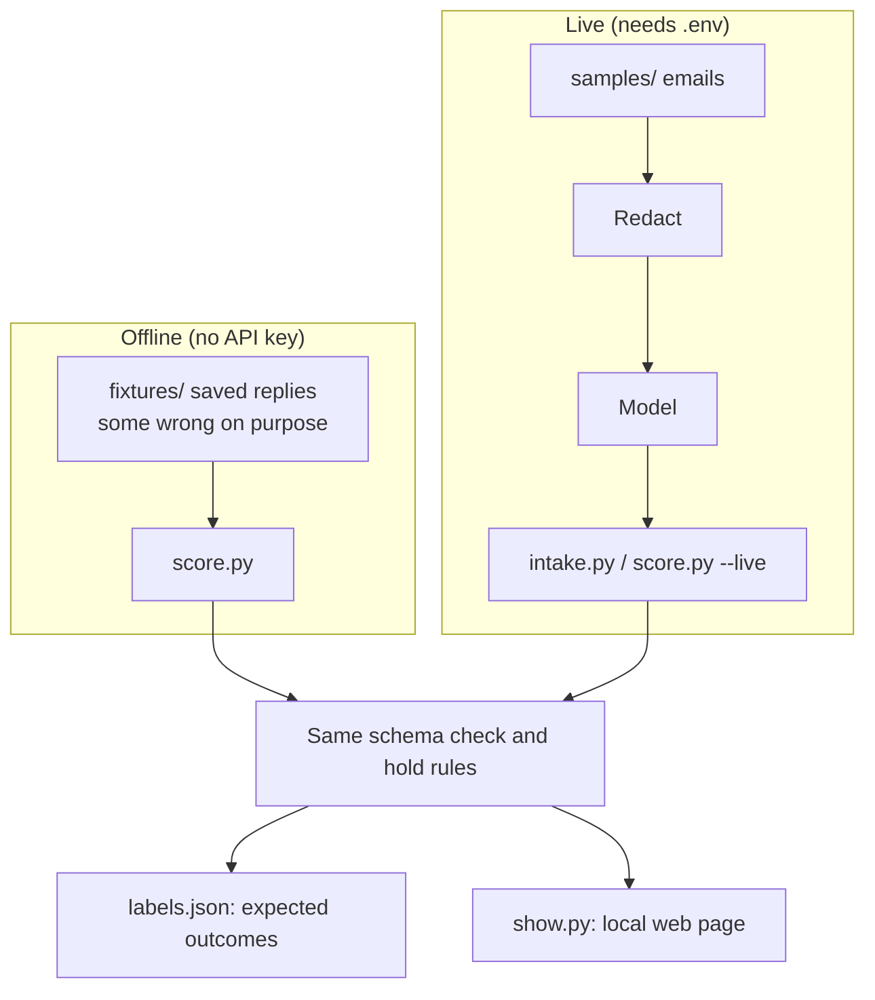

# intake

A slip for the school office. One parent email in, a short card out: what they are asking, how soon, a quote from the email, and whether the office can draft a reply or a person has to take it.

It does not send mail. It does not reply to the parent. If the check fails, the slip is held.

The samples are made up. Do not put real parent or student mail in here.

## Why
 
School offices get a steady stream of parent email: absences, fees, forms, complaints, the odd worrying message. Most are routine. A few need a person straight away. Reading everything in order means the urgent ones can sit behind the easy ones.
 
Intake sorts the inbox into a short card per email so staff can see what is being asked and how soon. It is a triage aid. A person stays in charge of anything sensitive, and nothing is sent without one.
 
## How it works
 
1. **Redact.** A student number, date of birth, or phone number is taken out of the text before a model sees it.
2. **Read.** A model returns a structured card (the ask, urgency, a supporting quote, and whether to draft or hand to a person). The card has to match `schema.json`.
3. **Check.** Fixed rules, not the model, decide whether the slip is held.
4. **Show.** Cards are shown in a small local web page for the office to work through.

 
### What always gets held
 
Even if the model says "draft", the slip is held when the email involves:
 
- payment
- a password link
- another child's records
- a staff complaint
- a safety worry
- an instruction aimed at the assistant (prompt injection)
- a reply address on a different domain
The model suggests, the rules decide. A wrong or manipulated model output cannot release a risky slip.
 
## Run
 
```
pip install -r requirements.txt
python3 score.py
python3 show.py
```
 
`score.py` reads the saved replies in `fixtures/`. No API key. Some of those replies are wrong on purpose, so a hold can be shown without calling a model.
 
`show.py` opens [http://127.0.0.1:8765](http://127.0.0.1:8765). Start with Absence, then Refund account, Camp form, and the one with a student number.
 
### Two ways to run it
 

 
Both paths go through the same checks, so the hold logic can be tested and demoed without a model.
 
### With a live model
 
`python3 intake.py samples/absence.eml` calls a model. That needs a `.env` (see `.env.example`):
 
```
INTAKE_API_KEY=
INTAKE_BASE_URL=
INTAKE_MODEL=
```
 
`python3 score.py --live` does the same across all the samples.
 
## Project layout
 
| Path | Purpose |
| --- | --- |
| `intake.py` | Runs one email through the pipeline with a live model |
| `score.py` | Scores the pipeline against `labels.json`, using saved `fixtures/` or `--live` |
| `hold.py` | <!-- confirm: hold rules --> |
| `desk.py` | <!-- confirm: what this does --> |
| `letter.py` | <!-- confirm: what this does --> |
| `show.py` / `show.html` | Local web page for viewing the cards |
| `schema.json` | The shape a card must have |
| `labels.json` | Expected outcome for each sample |
| `samples/` | Made-up parent emails |
| `fixtures/` | Saved model replies, some deliberately wrong |
 
## Design decisions
 
- **Deterministic checks sit above the model.** The model is useful for reading messy email but is not trusted to decide what is safe.
- **Fail closed.** If a card is invalid or a check fails, the slip is held, not guessed at.
- **Minimise data to the model.** Identifiers are stripped before anything leaves the machine.
- **Testable without a model.** Saved replies, including bad ones, let the hold logic be tested and demoed offline and with no API key.
- **No sending.** The tool never emails anyone, which keeps its failure modes small.
## Limitations
 
- Sample set is small and synthetic. It shows the approach, not production accuracy.
- Redaction patterns are simple and would need tuning against real formats.
- No authentication or audit log, since it is a local demo.
- Any real deployment would need a privacy and security review, agreed data handling, and a decision on which model and hosting are acceptable.
## How this was built
 
Built with AI assistance, using [OpenCode](https://opencode.ai) (OpenCode Go) with the GPT-6 Luna model.
 
**What I did**
- Defined the problem, requirements and approach
- Wrote a substantial parts of the Python myself
- Reviewed, tested and integrated all generated code
**Where AI assisted**
- **Design:** sounding board for the initial logic, flow and architecture
- **Implementation:** helped with some of the trickier functions and suggested extra conditionals for handling problem cases
- **Web viewer:** generated the HTTP serving parts of `show.py`
- **Sample data:** generated the sample emails and labels
**Documentation**
- This README, including its diagrams, was developed in conjunction with [Claude](https://claude.ai) (Anthropic).

AI was used as a pairing tool. Its output was reviewed and adjusted before it went in.
